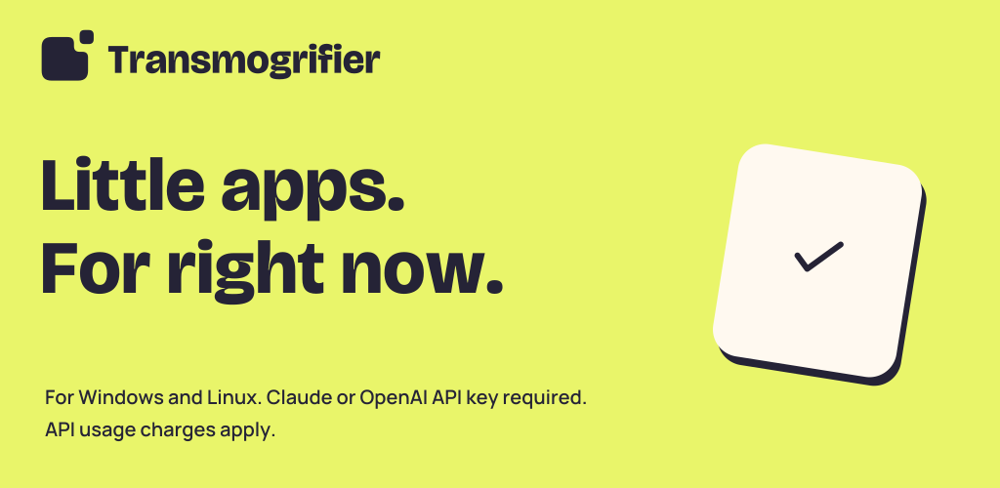

# Transmogrifier

**Little apps. For right now.**

Describe a scorekeeper for tonight, a checklist for the weekend, or another little app you would like to use. Transmogrifier makes it on your Windows or Linux computer. Open it in its own window and ask for changes as you go. Your apps stay until you delete them.

Apps are written by the AI service you connect in Settings:

| Service | Works with |
| --- | --- |
| **Claude** | Anthropic API |
| **ChatGPT** | OpenAI API |
| **Gemini** | Google AI Studio (Gemini API) |
| **OpenAI-compatible** | OpenRouter, Groq, Together AI, Fireworks AI, Mistral, DeepSeek, xAI, Cerebras, and any other service that accepts OpenAI's chat completions format |
| **Local model** | Ollama, LM Studio, llama.cpp, vLLM, Jan, and any other server with an OpenAI-compatible address |

A hosted service needs your own API key, and requests are billed to that account. There is no sign-in with a Claude, ChatGPT, or Gemini subscription. A local model needs no key and costs nothing to use. With an OpenAI-compatible service or a local model, choose a model that supports tool calling.

## Requirements

- A computer running Windows 10 or later, or Linux with WebKitGTK 4.1.
- One AI service: an API key from the [Claude Console](https://console.anthropic.com/), the [OpenAI Platform](https://platform.openai.com/api-keys), [Google AI Studio](https://aistudio.google.com/apikey), or an OpenAI-compatible service, or a local model server.
- On Linux, a running Secret Service keyring (GNOME Keyring or KWallet), which is where API keys are kept. A local model without a key doesn't need it.

## Using the app

### Set up

1. On first launch, the app opens **Settings**, with a card for each AI service. Open the card for yours.
   - **Claude**, **ChatGPT**, or **Gemini**: paste your API key, click **Save**, then **Check connection**. A passing check shows how many models the key can use. The **Model for new apps** has a default; after a check you can choose another.
   - **OpenAI-compatible** or **Local model**: choose your service under **Works with** to fill in its usual **Server address**, or type the address, and click **Save**. Save an API key if the service needs one; a local server usually doesn't. Click **Check connection**, then choose the **Model for new apps** from the server's models.
2. If more than one service is ready, choose one under **AI service for new apps**. Each app keeps the service and model it was made with.
3. The defaults are ready to use. Open **Advanced settings** to adjust:
   - **Thinking effort**: how much the model reasons before answering. More thinking can take longer and cost more. OpenAI-compatible services and local models use their own setting.
   - **Steps per request**: how many steps the model may take for one request before it pauses.
   - **Reply limit (tokens)**: the length limit for each model reply. These limits are not spending limits. OpenAI-compatible services and local models set their own reply limit.
   - **Instructions for all apps**: standing instructions the model follows in every app, such as "Use large text". Changes apply from each app's next request.

### Create an app

1. On the **Your apps** screen, click **New app** and give it a name.
2. Describe what you want, for example "a tip calculator with a slider", or click an example to fill the request box. Click **Make app** (or press Enter) when ready. Shift+Enter adds a line.
3. The chat shows the model's progress as it writes the files, along with the token usage for each step. The **Files** tab beside it lists the generated files, and clicking one opens a read-only view of its code.
4. Send follow-up requests, such as "make the button blue", to change the app.

**Stop** interrupts a generation. After a stop, an error, or the step limit, **Continue** picks up where it left off.

### Run an app

Click **Open app** to open the app in its own window, next to the chat. While it is open:

- **Show app** brings its window to the front.
- **Reload** loads the app again, including any changes. An open app also reloads by itself when a request finishes.
- **Close app** closes its window.
- **Error details** shows the app's log. A badge counts the errors.
- **Try to fix it**, above the request box, asks the model to fix the errors. This sends error details and relevant app context to your AI service; usage charges apply.

### Manage apps

Click an app on the **Your apps** screen to open its chat. If the app has been made, it also opens in its own window. The **⋮** button on each app has:

- **Rename**: the model uses your app's name, and picks up a new name on your next request.
- **Export app files**: saves a zip of the app alone, ready to host anywhere.
- **Back up**: saves a zip of the app with its conversation.
- **Reset conversation**: forgets the conversation and keeps the app and its files. Use it when requests outgrow your AI service's token limits (Groq's free tier, say) or changes keep going wrong. The AI service starts again from the app's files.
- **Add desktop shortcut**: a shortcut that opens Transmogrifier straight to the app, or to its chat if nothing has been made yet.
- **Delete app**.

**Import app** opens either kind of zip as a new app. A backup can be imported with or without its conversation. Each app keeps the service and model it was created with.

## Privacy and safety

- API keys are kept in the system credential store (Windows Credential Manager, or the Secret Service on Linux) and never written to the app's own files. Each is sent only to the service it belongs to; a key saved for an OpenAI-compatible service or a local model is sent to the address you entered.
- Generated apps run in their own windows, which can't use any of Transmogrifier's own functions or read the API keys.
- Generated apps can't use the network by default: requests to other sites are blocked. The "Let apps use the network" checkbox in Advanced settings lets them fetch data from, and show images and media from, other https sites. Plain http, remote scripts, styles, and fonts, and form posts stay blocked. Links to other sites open in your regular browser, after you confirm.
- Each generated app has its own storage, so apps can't read each other's saved data.
- Your descriptions and relevant app context are sent to your AI service when you create or change an app.

## Building from source

See [DEVELOPMENT.md](DEVELOPMENT.md).

## License

[MIT](LICENSE)
